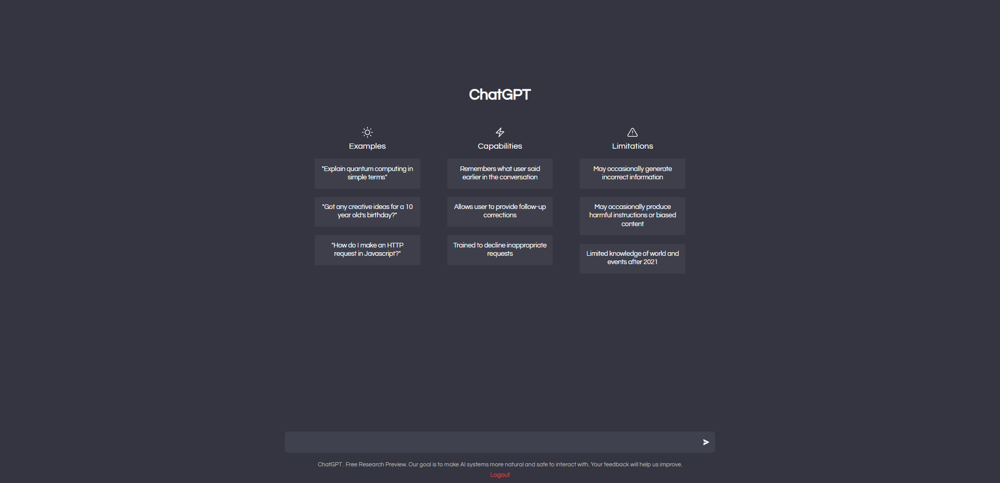
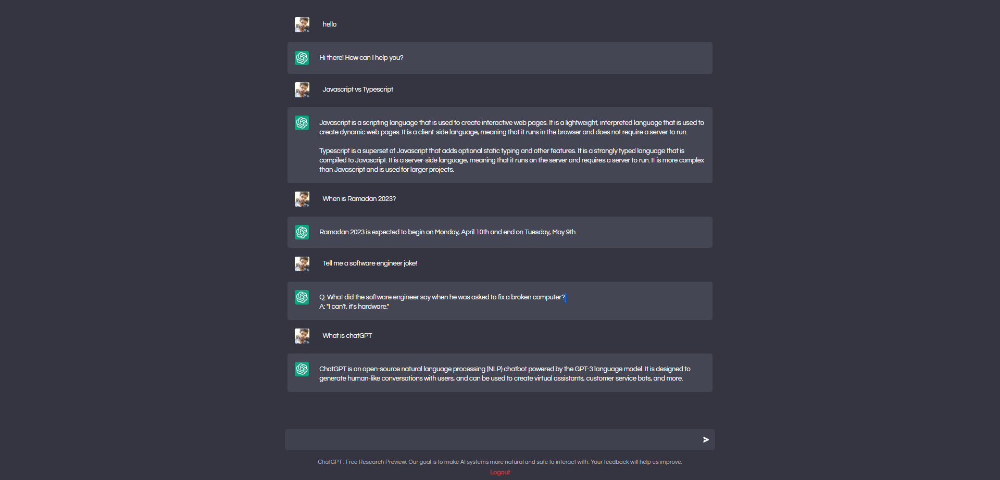

# Simple Chatbot — OpenAI-powered Chat Application




A lightweight, extensible chat application that demonstrates how to integrate the OpenAI API (GPT) with a Node.js + Express backend and a React + Vite TypeScript frontend. This repository provides a simple authentication flow, per-user API keys, and persistence for conversation history.

Table of Contents
- Overview
- Features
- Tech Stack
- Quick Start
- Environment Variables
- API Endpoints
- Deployment
- Contributing
- License

Overview
--------

This project is a minimal, production-ready example that shows how to wire an OpenAI completion model into a full-stack app. The backend exposes REST endpoints for user signup/login and chat operations; the frontend (in the `client/` folder) provides a responsive UI to interact with the bot.

Features
--------
- User signup and login with generated API keys
- Per-user conversation persistence
- Server-side OpenAI integration for completions
- Simple, modern React + Vite frontend (TypeScript)

Tech Stack
----------
- Backend: Node.js, Express, Mongoose
- Frontend: React, Vite, TypeScript
- AI: OpenAI API (via `openai` npm package)

Quick Start
-----------

Prerequisites
- Node.js 18+ and npm/yarn
- MongoDB (local or hosted)
- An OpenAI API key

Install and run the server

1. Install server dependencies:

```bash
npm install
```

2. Install client dependencies and build (from `client/`):

```bash
cd client
npm install
```

3. Create a `.env` file in the project root (see Environment Variables below).

4. Start the server (development):

```bash
npm run dev
```

5. Start the frontend (in a separate terminal):

```bash
cd client
npm run dev
```

Open the client at the URL shown by Vite (usually `http://localhost:5173`). The backend listens on `process.env.PORT` or `8000` by default.

Environment Variables
---------------------
Create a `.env` file in the repository root with the following variables:

```env
OPENAI_API_KEY=your_openai_api_key
MONGO_URI=your_mongodb_connection_string
PORT=8000 # optional
```

- `OPENAI_API_KEY` — used by the backend to call OpenAI via [chatGTP.js](chatGTP.js).
- `MONGO_URI` — MongoDB connection string used by [server.js](server.js).

API Endpoints
-------------
Key backend routes (mounted in [server.js](server.js)):

- `POST /auth/signup` — create a new user (returns user record with generated API key)
- `POST /auth/login` — login with username/password
- `POST /chatgpt/chat/:apiKey` — send a message to the bot (requires valid API key)
- `GET /chatgpt/getchats/:apiKey` — retrieve conversation history for the user

Relevant source files:
- Server entry: [server.js](server.js)
- OpenAI integration: [chatGTP.js](chatGTP.js)
- Auth controller: [controllers/auth.js](controllers/auth.js)
- Chat controller: [controllers/chat.js](controllers/chat.js)
- API key middleware: [middlewares/apiKey.js](middlewares/apiKey.js)
- Routes: [routers/auth.js](routers/auth.js), [routers/chat.js](routers/chat.js)
- Frontend: [client/](client)

Deployment
----------
This project can be deployed to platforms that support Node.js and static frontends (for example, Vercel, Heroku, or a VPS). If using Vercel for the frontend and a separate host for the backend, set the same `OPENAI_API_KEY` and `MONGO_URI` environment variables on the target hosts.

Notes & Security
----------------
- Keep `OPENAI_API_KEY` and database credentials secret. Do not commit `.env` to source control.
- Generated API keys in this project are stored in the `User` model and used to identify/authorize requests — rotate/revoke keys as needed.
- The backend currently uses the OpenAI completion endpoint `text-davinci-003` in [chatGTP.js](chatGTP.js); consider upgrading to newer chat models and request patterns for better conversation handling.

Contributing
------------
Please open an issue or a pull request. Suggested improvements:
- Add tests and CI
- Improve error handling and validation
- Support streaming responses or chat-based models

License
-------
This project is provided under the terms in the `LICENSE` file.

Questions or help
-----------------
If you want, I can:
- add example `.env.example` file
- add scripts to run backend + frontend together
- create a sample Postman collection for the API

---
Created README: concise, actionable instructions and links to core files.
